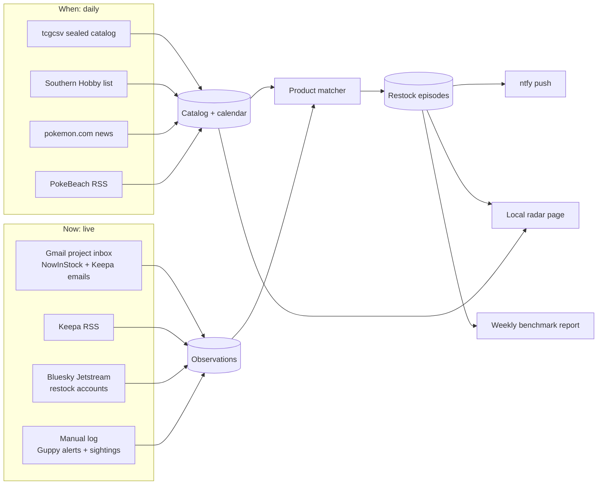

# OpenTCG build-out 1: release calendar, alert inbox, live feed

**Status (2026-09-29):** Slices 0–5 are built and running, with three LaunchAgents and a 6 AM sign-in check. Slice 6's radar page and weekly report and slice 7's Shopify pilot are not built. Follow-up work is tracked in the [OpenTCG audit backlog](../products/open-tcg/09-audit-2026-09-29.md). This is the first build of the [data-source plan](2026-09-25-open-tcg-data-sources-plan.md).

**Goal:** In about two working weeks, get a local radar on the always-on Mac that does five things:

- Keeps an upcoming-release calendar for sealed Pokémon TCG.
- Turns the founder's alert inbox and a public Bluesky feed into one live restock feed.
- Pushes deduplicated alerts to the founder's phone.
- Logs Guppy's alerts so the two can be compared.
- Measures which source saw each restock first.

**Scope changes from the data-source plan (founder, 2026-09-25):**

- **Best Buy is skipped for now.** Every Pokémon TCG release there is invitation-only, so its API would mostly report invite windows, not buyable restocks.
- **Kroger is deferred.** Its API only helps if a Kroger-family grocery store is nearby, and those mostly carry checkout-lane packs, blisters and tins.
- **camelcamelcamel is dropped.** Keepa covers Amazon.
- **Project inbox:** a dedicated Gmail address already subscribed to NowInStock and Keepa.

## What gets built



**The core idea is the restock episode.** One product at one retailer going in stock is a single episode, even when NowInStock, Keepa, Bluesky and Guppy all report it. The first report opens the episode, and later reports attach to it with their lag. That gives three things at once: a single phone push instead of four, a "which source was first" answer, and the join key for comparing with Guppy.

## Code layout (proposed)

This follows the `products/pokemon-tcg-search` precedent: Python, SQLite, a Makefile and launchd. Runtime data stays inside the product's git-ignored `data/` folder.

```text
products/open-tcg/
  Makefile                 setup · test · calendar · daemon · report · serve
  radar/
    __main__.py            CLI: init-db, calendar, daemon, log, report, sources
    config.py              reads data/config.toml (inbox, Keepa RSS URL, ntfy topic, Bluesky accounts, quiet hours)
    db.py  schema.sql
    catalog/               tcgcsv sealed ingest, product-type + exclusive parser, alias matcher
    sources/               southern_hobby, pokemon_news, pokebeach_rss, keepa_rss
    inbox/                 IMAP IDLE reader + parsers/{nowinstock,keepa}
    stream/                Bluesky Jetstream subscriber + post parser
    episodes.py            grouping, dedupe, lag
    notify/                ntfy sender, cooldowns, quiet hours, digest
    report/                weekly benchmark vs Guppy log
  web/                     single local page: Upcoming · Live · Sources
  tests/fixtures/          sanitized real emails, tcgcsv JSON, Jetstream events, RSS
  scripts/                 launchd plists (installed only after founder approval)
  data/                    git-ignored: radar.db, config.toml, secrets/
```

## Data model (v0)

| Table | Purpose | Key rules |
|---|---|---|
| `products` | Canonical sealed products from tcgcsv | `product_id` = TCGplayer ID. Also holds set, `product_type` (ETB, booster box, bundle, blister, tin, collection…), `exclusive_retailer` parsed from the name, release date, presale flag and `first_seen_at` |
| `product_aliases` | Maps retailer or alert wording and ASINs to `product_id` | Normalized text, plus a manual confirm step for new aliases |
| `sources` | Registry and health | Tier, cadence, enabled flag, `last_success_at`, `consecutive_failures` |
| `calendar_events` | Events: announced, SKU added, release date changed, order due, presale price | Idempotent per (source, subject, value) |
| `observations` | One row per alert or post received | Append-only. Holds `source_time` (e.g. email `Date`, post `createdAt`), `received_at`, retailer, status, price and URL. `product_id` can be null until matched. |
| `episodes` + `episode_sources` | Restock episodes and each source's lag | Window of 30 min per (product or text, retailer) |
| `notifications` | Push outbox | Unique `dedupe_key`, per-episode cooldown |
| `manual_log` | Guppy alerts and in-store sightings | Kind, retailer, product text, time seen, note |

## Slices, in build order

Each slice is test-first: write fixture tests before code. A slice is done when its tests pass and its live check passes.

| # | Slice | Needs from founder | Done when |
|---|---|---|---|
| 0 | Skeleton: product folder, schema, source registry, CLI, `make test`, per-source health | nothing | `make test` is green and `radar sources` lists every source with its health |
| 1 | Catalog and calendar: tcgcsv sealed ingest (category 3), type and exclusive parsing, presale price per day | nothing | Live run lists all 21 Delta Reign SKUs with release dates, the Target and Pokémon Center exclusives and presale prices. A re-run creates no duplicates; a fixture with an added SKU emits one `sku_added` event |
| 2 | News and distributor watchers: Southern Hobby diff, pokemon.com news, PokeBeach RSS | nothing | Fixture diffs emit `order_due` and `announced` events; the live run records Delta Reign's 09/06 order-due and 11/06 release |
| 3 | Inbox: IMAP IDLE reader (never marks, moves or deletes mail), NowInStock and Keepa email parsers, Keepa RSS reader, product matcher, unmatched queue | Gmail access (below), NowInStock item alerts on, Keepa tracking + RSS on, and 3–5 real alert emails for fixtures | Every fixture email parses to retailer, product text, status, price, link and alert time. A live alert lands as an observation within 60 s of arriving in Gmail |
| 4 | Bluesky stream: Jetstream subscriber filtered to chosen accounts, post parser | pick accounts (starting list: @pokemonrestocks, @nowinstockus) | Recorded events parse correctly; the subscriber reconnects after a network drop and resumes from its cursor |
| 5 | Episodes and push: grouping, first-source lag, ntfy push, quiet hours, daily digest, manual `radar log guppy …` / `radar log sighting …` | an ntfy topic and the phone app | Four reports of one restock produce one push and four `episode_sources` rows; a stale source sends one "source down" push |
| 6 | Radar page, weekly report, launchd | approval to install two launchd agents | The page shows Upcoming, Live and Sources; the report compares against Guppy; the daemon survives a reboot |
| 7 | Stretch: Shopify local-store pilot | home ZIP and a radius | 10–25 stores polled politely. These report both in-stock and sold-out, so this is the first source that measures how long stock stays buyable. |

**Progress 2026-09-25:**
- Slices 0–2 are built in `products/open-tcg/` with 61 passing tests. The live baseline holds 856 sealed products across 7 sets, 41 Southern Hobby listings and 30 PokeBeach items.
- pokemon.com was dropped as a source: it serves an Incapsula bot challenge to non-browser clients, and we don't bypass that.
- tcgcsv stamps undated legacy groups with its build time, so the radar treats non-midnight dates as unknown.
- Phone push (ntfy) is paused at the founder's request, so slice 5 will add native macOS notifications.
- **2026-09-26:** slice 4 is built. It follows the Bluesky Jetstream, filtered to @pokemonrestocks and @nowinstockus, with a resume cursor and a startup backfill from the author feed. Each post is classified by signal (drawing open or scheduled, results, invites, queue, drop, in stock, pre-order, cancelled), retailer and TCG relevance, then matched to the watchlist, including "ETB" abbreviations and multi-product posts. The first backfill stored 59 posts. The live connection is proven. python.org Python lacks system TLS roots, so the stream uses certifi.
- **2026-09-26:** slice 5 is built with macOS notifications in place of ntfy. It includes:
  - restock episodes (60-minute window, per watched item or product text, per retailer and signal family)
  - per-source lag, and a scorecard scoring each Bluesky account and Guppy separately on times first, median lag and accuracy from founder verdicts
  - `radar mark`, and `radar log guppy|sighting`
  - one notification per fresh (<15 min) watched availability episode, with a price-threshold guard
  - Background service (slice 6, launchd part) installed 2026-09-26 at the founder's request. The stream agent is KeepAlive with RunAtLoad. The sync agent runs every 15 min, and `radar sync` polls only due sources (tcgcsv once after its 20:30 UTC rebuild). Install, remove and inspect with `scripts/launchd.sh`. Notifications are verified from the launchd context.
  - **2026-09-27:** slice 3 is built: a read-only IMAP reader (EXAMINE + BODY.PEEK, UIDVALIDITY-aware cursor). It takes any Pokémon mail plus NowInStock and Keepa, is scored per sender, and runs as an inbox LaunchAgent. Only account-confirmation emails have arrived so far, so the NowInStock and Keepa parsers still use synthetic fixtures.
  - **2026-09-27:** the watchlist gained `[exclude]` terms (Pitch Black, Chaos Rising) and a Costco rule: any Costco drop naming a watched item or set alerts and opens the page in Brave, but only after the link is verified to land on costco.com.
  - X/Twitter is excluded for now: its API is pay-per-read (~$20–25/month for a few accounts) and scraping is against its terms. Revisit once the scorecard shows which alert accounts lead.

**Estimate:** slices 0–6 take about 8–10 working days, then a 7-day soak with the founder using it.

**Order:** slices 0–2 and 4 need nothing from the founder, so building starts there. Slice 3 waits on Gmail access and a few real alert emails.

## Running it

- **Always-on daemon (launchd KeepAlive).** It runs the Jetstream subscriber, holds an IMAP IDLE connection to the project inbox (reconnecting at least every 29 min), checks Keepa and PokeBeach RSS every 5–15 min, and sends pushes. Every source records its health.
- **Daily job.** After tcgcsv's ~20:00 UTC rebuild, it runs tcgcsv, then Southern Hobby, then pokemon.com, then the calendar digest.
- **Politeness.** Each source uses an identifying User-Agent and a declared cadence: 0.25 s between tcgcsv calls, one request at a time per host, and backoff on 429.
- **Install.** Installing launchd agents is a persistent system change, so it happens only after the founder approves it in slice 6.

## Founder setup for build-out 1

Status 2026-09-25: steps 1–2 are done by Claude through the founder's Brave browser, and the list lives in [`products/open-tcg/watchlist.toml`](../../products/open-tcg/watchlist.toml).

1. **NowInStock (done):** 12 tracker alerts, email and browser delivery, in-stock and pre-order. NowInStock has no custom items, so 9 of the 18 watchlist items have no tracker yet and none has a Walmart one. A product suggestion covering them was drafted for the founder to submit past the reCAPTCHA. Subscriptions expire after 180 days.
2. **Keepa (done):** 18 Amazon trackings with Buy Box and Amazon desired price at each item's `alert_at`, alert rearm timer 1 day. No RSS link appeared, so email is the channel.
3. **Gmail access for the lab (founder chose IMAP):** an app password on the project Gmail, read over IMAP with IDLE, so new mail arrives in seconds with no weekly expiry.
   - This needs 2-Step Verification on the account. The founder creates the app password and stores it with a no-echo terminal command in `products/open-tcg/data/secrets/gmail-app-password` (git-ignored, mode 0600). Claude never handles the value.
   - Why not OAuth: publishing an OAuth app to production needs a public home page and privacy policy on a domain the founder controls. Leaving it in *Testing* expires Gmail refresh tokens every 7 days. An unused `open-tcg` Cloud project with its consent screen stays available if read-only OAuth is wanted later.
   - The inbox reader is IMAP instead of the Gmail API, and it treats every message as read-only data.
4. **ntfy:** install the phone app and use a long random topic name. ntfy.sh topics are readable by anyone who knows the name.
5. **Optional Claude Gmail connector:** lets a chat session pull real alert emails to turn into sanitized test fixtures. The radar never depends on it. Chat sessions treat email content as data only.

## Guardrails

- **Email is untrusted input.** Parsers are deterministic code. Nothing in an email can trigger an action beyond recording an observation.
- **Aggregator data stays personal.** NowInStock and Keepa data isn't redistributed and the radar page isn't shared. Sharing would change the source terms.
- **No logins or checkout.** The radar reads and notifies. It never signs in to a retailer, opens a cart or touches Guppy's data.
- **Unknown stays unknown.** An unmatched alert still pushes, labeled with its raw text, and joins the confirm-alias queue. A missing price stays blank.

## After build-out 1

1. The soak week produces the first benchmark report: which source was first, the lag against Guppy, what each side missed, and false alerts.
2. That report decides build-out 2: the Shopify local-store lane (if the pilot is promising), Reddit RSS, Discord channel follows, and whether Best Buy or Kroger earn their way back.
