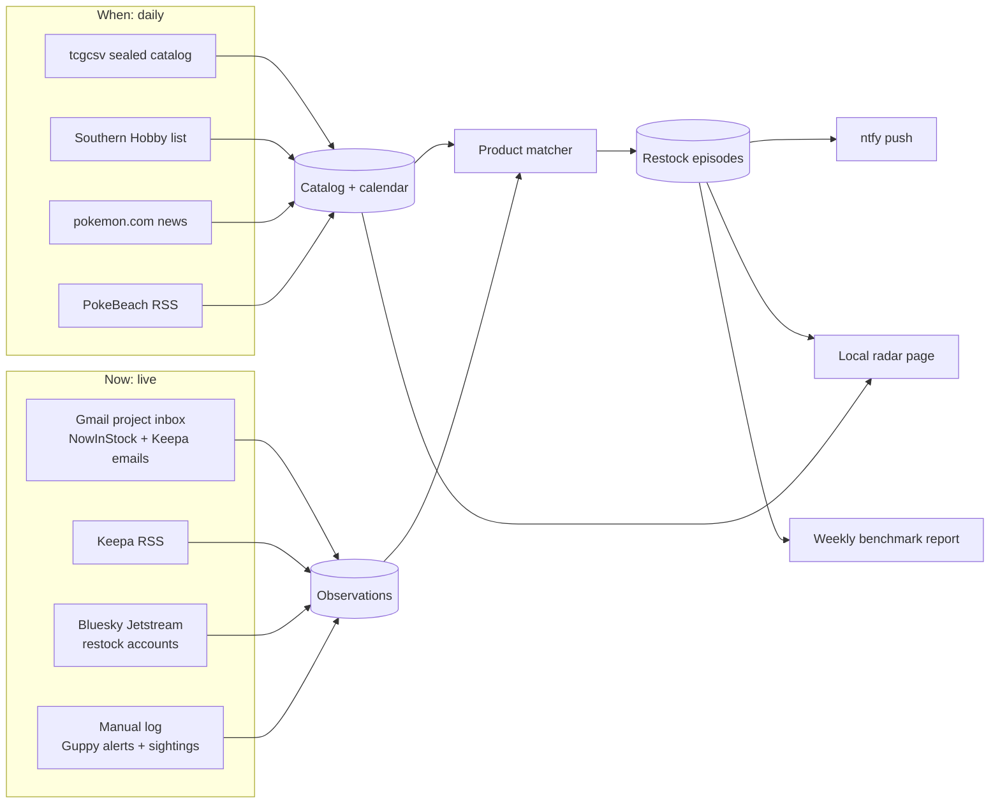

# OpenTCG build-out 1: release calendar, alert inbox, live feed

**Status:** Proposed implementation plan. No code, accounts, OAuth clients or scheduled jobs exist yet. This is the first build of the [data-source plan](2026-09-25-open-tcg-data-sources-plan.md).

**Goal:** In about two working weeks, get a local radar on the always-on Mac that does five things:

- Keeps an upcoming-release calendar for sealed Pokémon TCG.
- Turns the founder's alert inbox and a public Bluesky feed into one live restock feed.
- Pushes deduplicated alerts to the founder's phone.
- Logs Guppy's alerts so the two can be compared.
- Measures which source saw each restock first.

**Scope changes from the data-source plan (founder, 2026-09-25):**

- **Best Buy is skipped for now.** Every Pokémon TCG release there is invitation-only, so its API would mostly report invite windows, not buyable restocks.
- **Kroger is deferred.** Its API only helps if a Kroger-family grocery store is nearby, and those mostly carry checkout-lane packs, blisters and tins.
- **camelcamelcamel is dropped.** Keepa covers Amazon.
- **Project inbox:** a dedicated Gmail address already subscribed to NowInStock and Keepa.

## What gets built



**The core idea is the restock episode.** One product at one retailer going in stock is a single episode, even when NowInStock, Keepa, Bluesky and Guppy all report it. The first report opens the episode, and later reports attach to it with their lag. That gives three things at once: a single phone push instead of four, a "which source was first" answer, and the join key for comparing with Guppy.

## Code layout (proposed)

This follows the `products/pokemon-tcg-search` precedent: Python, SQLite, a Makefile and launchd. Runtime data stays inside the product's git-ignored `data/` folder.

```text
products/open-tcg/
  Makefile                 setup · test · calendar · daemon · report · serve
  radar/
    __main__.py            CLI: init-db, calendar, daemon, log, report, sources
    config.py              reads data/config.toml (inbox, Keepa RSS URL, ntfy topic, Bluesky accounts, quiet hours)
    db.py  schema.sql
    catalog/               tcgcsv sealed ingest, product-type + exclusive parser, alias matcher
    sources/               southern_hobby, pokemon_news, pokebeach_rss, keepa_rss
    inbox/                 gmail reader + parsers/{nowinstock,keepa}
    stream/                Bluesky Jetstream subscriber + post parser
    episodes.py            grouping, dedupe, lag
    notify/                ntfy sender, cooldowns, quiet hours, digest
    report/                weekly benchmark vs Guppy log
  web/                     single local page: Upcoming · Live · Sources
  tests/fixtures/          sanitized real emails, tcgcsv JSON, Jetstream events, RSS
  scripts/                 launchd plists (installed only after founder approval)
  data/                    git-ignored: radar.db, config.toml, secrets/
```

## Data model (v0)

| Table | Purpose | Key rules |
|---|---|---|
| `products` | Canonical sealed products from tcgcsv | `product_id` = TCGplayer ID. Also holds set, `product_type` (ETB, booster box, bundle, blister, tin, collection…), `exclusive_retailer` parsed from the name, release date, presale flag and `first_seen_at` |
| `product_aliases` | Maps retailer or alert wording and ASINs to `product_id` | Normalized text, plus a manual confirm step for new aliases |
| `sources` | Registry and health | Tier, cadence, enabled flag, `last_success_at`, `consecutive_failures` |
| `calendar_events` | Events: announced, SKU added, release date changed, order due, presale price | Idempotent per (source, subject, value) |
| `observations` | One row per alert or post received | Append-only. Holds `source_time` (e.g. email `Date`, post `createdAt`), `received_at`, retailer, status, price and URL. `product_id` can be null until matched. |
| `episodes` + `episode_sources` | Restock episodes and each source's lag | Window of 30 min per (product or text, retailer) |
| `notifications` | Push outbox | Unique `dedupe_key`, per-episode cooldown |
| `manual_log` | Guppy alerts and in-store sightings | Kind, retailer, product text, time seen, note |

## Slices, in build order

Each slice is test-first: write fixture tests before code. A slice is done when its tests pass and its live check passes.

| # | Slice | Needs from founder | Done when |
|---|---|---|---|
| 0 | Skeleton: product folder, schema, source registry, CLI, `make test`, per-source health | nothing | `make test` is green and `radar sources` lists every source with its health |
| 1 | Catalog and calendar: tcgcsv sealed ingest (category 3), type and exclusive parsing, presale price per day | nothing | Live run lists all 21 Delta Reign SKUs with release dates, the Target and Pokémon Center exclusives and presale prices. A re-run creates no duplicates; a fixture with an added SKU emits one `sku_added` event |
| 2 | News and distributor watchers: Southern Hobby diff, pokemon.com news, PokeBeach RSS | nothing | Fixture diffs emit `order_due` and `announced` events; the live run records Delta Reign's 09/06 order-due and 11/06 release |
| 3 | Inbox: Gmail reader (read-only), NowInStock and Keepa email parsers, Keepa RSS reader, product matcher, unmatched queue | Gmail access (below), NowInStock item alerts on, Keepa tracking + RSS on, and 3–5 real alert emails for fixtures | Every fixture email parses to retailer, product text, status, price, link and alert time. A live alert lands as an observation within 60 s of arriving in Gmail |
| 4 | Bluesky stream: Jetstream subscriber filtered to chosen accounts, post parser | pick accounts (starting list: @pokemonrestocks, @nowinstockus) | Recorded events parse correctly; the subscriber reconnects after a network drop and resumes from its cursor |
| 5 | Episodes and push: grouping, first-source lag, ntfy push, quiet hours, daily digest, manual `radar log guppy …` / `radar log sighting …` | an ntfy topic and the phone app | Four reports of one restock produce one push and four `episode_sources` rows; a stale source sends one "source down" push |
| 6 | Radar page, weekly report, launchd | approval to install two launchd agents | The page shows Upcoming, Live and Sources; the report compares against Guppy; the daemon survives a reboot |
| 7 | Stretch: Shopify local-store pilot | home ZIP and a radius | 10–25 stores polled politely. These report both in-stock and sold-out, so this is the first source that measures how long stock stays buyable. |

**Estimate:** slices 0–6 take about 8–10 working days, then a 7-day soak with the founder using it.

**Order:** slices 0–2 and 4 need nothing from the founder, so building starts there. Slice 3 waits on Gmail access and a few real alert emails.

## Running it

- **Always-on daemon (launchd KeepAlive).** It runs the Jetstream subscriber, polls Gmail every 30 s, checks Keepa and PokeBeach RSS every 5–15 min, and sends pushes. Every source records its health.
- **Daily job.** After tcgcsv's ~20:00 UTC rebuild, it runs tcgcsv, then Southern Hobby, then pokemon.com, then the calendar digest.
- **Politeness.** Each source uses an identifying User-Agent and a declared cadence: 0.25 s between tcgcsv calls, one request at a time per host, and backoff on 429.
- **Install.** Installing launchd agents is a persistent system change, so it happens only after the founder approves it in slice 6.

## Founder setup for build-out 1

1. **NowInStock:** alerts are per item. Open the Pokémon trackers page and add each current product you want. Start with current-era ETBs, booster bundles and booster boxes, and add Delta Reign items as trackers appear. Then switch on email alerts for each.
2. **Keepa:** track the Amazon listing (ASIN) for each product. Set the price type to **"Amazon"** and the threshold near retail price, so it fires when Amazon itself sells at retail rather than a reseller. Turn on the RSS channel and put its private URL in the lab config. Keep email on as a backup.
3. **Gmail access for the lab:** the lab needs its own read-only access, independent of any Claude chat. Two options, both set up and approved by the founder:
   - **Recommended:** a Google Cloud OAuth "desktop app" client with the `gmail.readonly` scope. Set the publishing status to **In production**; apps left in *Testing* get refresh tokens that expire after 7 days.
   - **Fallback:** IMAP with an app password, which requires 2-Step Verification on the account.
   - The token goes in `products/open-tcg/data/secrets/`, which is git-ignored with mode 0600.
4. **ntfy:** install the phone app and use a long random topic name. ntfy.sh topics are readable by anyone who knows the name.
5. **Optional Claude Gmail connector:** lets a chat session pull real alert emails to turn into sanitized test fixtures. The radar never depends on it. Chat sessions treat email content as data only.

## Guardrails

- **Email is untrusted input.** Parsers are deterministic code. Nothing in an email can trigger an action beyond recording an observation.
- **Aggregator data stays personal.** NowInStock and Keepa data isn't redistributed and the radar page isn't shared. Sharing would change the source terms.
- **No logins or checkout.** The radar reads and notifies. It never signs in to a retailer, opens a cart or touches Guppy's data.
- **Unknown stays unknown.** An unmatched alert still pushes, labeled with its raw text, and joins the confirm-alias queue. A missing price stays blank.

## After build-out 1

1. The soak week produces the first benchmark report: which source was first, the lag against Guppy, what each side missed, and false alerts.
2. That report decides build-out 2: the Shopify local-store lane (if the pilot is promising), Reddit RSS, Discord channel follows, and whether Best Buy or Kroger earn their way back.
