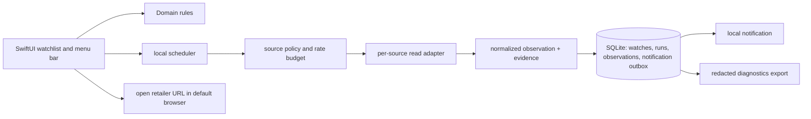
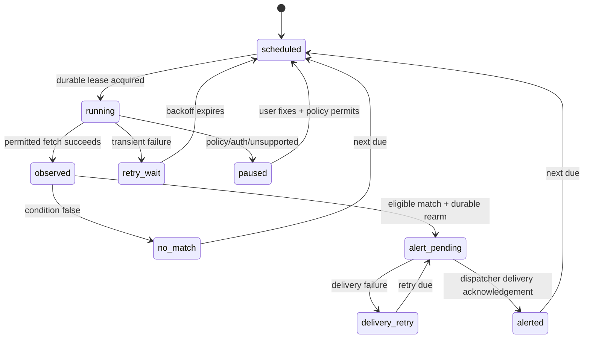

# OpenTCG architecture and security

**Proposed recommendation — pending founder direction:** build a Mac-first,
local-first watchlist client before attempting retailer automation. The first
public release would be a free, open-source app that
records product watches locally, checks only permitted sources, shows when a
result was last verified, and hands a ready-to-buy user to the retailer's own
browser flow. It does not store retailer passwords, payment data, cookies, or
queue credentials.

This is an independent implementation informed by the public category and the
founder brief. It must not copy Guppy source, assets, telemetry, interface
text, service contracts, or reverse-engineered behavior. Names, identifiers,
schema, tests, and UI must be original.

## Product boundary

The useful first promise is: “Tell me when a specific, permitted retail source
last observed an item available at my target price; show the evidence and take
me to the retailer.” `Observed` is deliberately not `guaranteed`: inventory and
price can change before the retailer page loads.

The v1 feature set is:

- manual product URLs and a small, provenance-labelled catalog;
- desired-price and availability watches, per variant where the source exposes
  one;
- on-device polling while the app is running, local notifications, history,
  error/freshness status, CSV/JSON export, and browser handoff;

Local-store radar is deferred until after v1. It requires a separately
permitted inventory source and a new, in-context location decision; v1 does
not request location.

It excludes scraping behind access controls, CAPTCHA/MFA defeat, session or
payment capture, queue joining, cart mutation, purchase submission, cloud
scanning paid for by an unspecified party, and claims of real-time coverage.
Those boundaries make a trustworthy free baseline possible and preserve a path
to later retailer-approved integrations.

## Architecture choices

| Option | Shape | Strength | Material cost/risk | Decision |
|---|---|---|---|---|
| A. Native local monolith | SwiftUI menu-bar/window app; Swift domain modules; SQLite; `URLSession` adapters | Least moving parts, native permissions/notifications, easy audit and low operating cost | Mac-only initially; shared engine must be extracted later | **Recommended for v1** |
| B. Native UI plus local Rust engine | SwiftUI client calls a signed Rust helper over XPC; SQLite owned by helper | Future portable engine and strict process boundary | IPC/versioning, signing, sandbox/helper deployment, and crash recovery are premature for a one-platform MVP | Revisit after two platforms or a CPU-heavy normalized catalog |
| C. Cloud control plane | thin clients plus hosted pollers, auth, shared catalog, push service | Cross-device background watches | Recurring scan/egress cost, centralized privacy/security obligation, source rate-limit concentration, and an account service | Defer until a funded, consented cloud offering |

Option A is deliberately a modular monolith, not a disposable prototype:
`CollectorApp` (SwiftUI/UI), `CollectorDomain` (pure models/rules),
`CollectorStore` (SQLite transactions), `CollectorAdapters` (source-specific
reads), `CollectorScheduler` (poll loop/backoff), and `CollectorDiagnostics`.
The domain and adapter contracts have no SwiftUI types, so a future engine or
other UI can reuse their semantics. The app owns one writer connection and may
use read connections for history views. SQLite WAL allows readers and a writer
to proceed concurrently on the same host, but its WAL and shared-memory files
are persistent state and must travel with a copied database
([SQLite WAL documentation](https://www.sqlite.org/wal.html)).

Store app data in the app container. App Sandbox restricts what the app itself
can access, but does **not** make files confidential from arbitrary same-user,
unsandboxed processes; it is a least-privilege boundary, not local data
encryption ([Apple: App Sandbox file access](https://developer.apple.com/documentation/security/accessing-files-from-the-macos-app-sandbox)).
Enable the outgoing-network entitlement and only the scoped user-selected
read/write file entitlement needed for explicit import/export dialogs. The app
must not request broad Downloads/Desktop/Documents access. App Sandbox is
required for Mac App Store distribution and remains useful for direct
distribution ([Apple: configuring App Sandbox](https://developer.apple.com/documentation/xcode/configuring-the-macos-app-sandbox)).



## Source adapter contract

No generic “retailer scraper” exists. Each adapter is versioned and registered
only after a source review records the allowed access method, terms/robots/API
constraints, data fields, rate/concurrency budget, attribution/link policy,
and disable switch. Approved implementations can use a documented public API,
affiliate/product feed, or a retailer-approved integration. An adapter must
return `unsupported` rather than approximate a restricted workflow.

```text
SourceAdapter.fetch(ProductRef, FetchContext) -> FetchResult
FetchResult = Observation | NotModified | SourceFailure | Unsupported
```

`FetchContext` carries a generated run ID, deadline, conditional validators,
and a per-source budget token; it never carries browser profiles, cookies,
passwords, payment data, proxy instructions, or CAPTCHA artifacts. An
`Observation` is immutable evidence: source ID/version, canonical product and
variant identifiers, URL, observed price/currency/availability, observed and
received timestamps, response validator, confidence, and a bounded,
non-sensitive evidence digest. Raw HTML is off by default; if a source review
allows short-lived samples for parser debugging, keep them in protected local
storage, redact them, cap retention, and never upload them automatically. If
future sensitive retained fields need encryption at rest, encrypt those fields
with a per-install key held in Keychain; do not claim all local SQLite data is
automatically encrypted.

Global normalizers must not silently change a retailer's meaning. Currency
minor units, stock status (`in_stock`, `out_of_stock`, `unknown`), and price
type (`item`, `shipping_inclusive`, `unknown`) stay explicit. A condition can
match only when the necessary fields are known. UI always displays source,
observation time, and stale/failed state beside an alert.

## Durable data contracts

Schema migrations are numbered and transactional. Use UTC ISO-8601 values and
UUIDv7/ULID identifiers generated locally. Foreign keys are on; every mutable
row has `revision`, `created_at`, and `updated_at`.

| Table | Required fields | Invariants |
|---|---|---|
| `products` | `id`, `canonical_url`, `title`, `source_id`, `variant_selector_json`, `status` | unique (`source_id`, `canonical_url`, normalized variant); no credentials in URL/query storage |
| `watches` | `id`, `product_id`, `condition_json`, `enabled`, `cadence_seconds`, `next_due_at`, `last_state` | condition schema versioned; cadence cannot undercut source budget |
| `check_runs` | `id`, `watch_id`, `attempt`, `parent_run_id`, `lease_owner`, `lease_expires_at`, `started_at`, `finished_at`, `outcome`, `error_code`, `adapter_version` | exactly one terminal outcome; a running lease is owned and expiring; retries retain their parent |
| `observations` | `id`, `check_run_id`, source/product fields, `observed_at`, `received_at`, `evidence_hash` | append-only; values are nullable only when source marks them unknown |
| `watch_alert_state` | `watch_id`, `rule_revision`, `match_latched`, `transition_sequence`, `last_material_fingerprint`, `cooldown_until` | one row/watch; unknown/stale/offline preserve a verified match latch; only verified no-match → match or a configured material price/stock change after cooldown can advance `transition_sequence` |
| `alerts` | `id`, `watch_id`, `observation_id`, `rule_revision`, `transition_sequence`, `material_fingerprint`, `state`, `notified_at` | unique (`watch_id`, `rule_revision`, `transition_sequence`, `material_fingerprint`) is durable alert dedupe; repeated identical polls do not become new alerts |
| `outbox` | `id`, `kind`, `payload_version`, `dedupe_key`, `state`, `attempts`, `not_before` | unique `dedupe_key`; reserved for replay-safe notification delivery, never browser handoff |
| `source_policies` | `source_id`, `adapter_version`, `enabled`, `min_interval`, `max_concurrency`, `reviewed_at` | a local user-disabled source cannot schedule new network work; remote revocation needs a separately designed authenticated, non-executable channel |
| `consents` | `scope`, `version`, `granted_at`, `revoked_at` | affirmative, revocable, auditable; scopes include notification, location, diagnostics export |

Secrets do not belong in this schema. If a future approved integration needs an
OAuth refresh token, store a small opaque reference in SQLite and the token in
the user's Keychain. Keychain Services provides encrypted storage for small
user secrets ([Apple: Keychain Services](https://developer.apple.com/documentation/security/keychain-services)).
v1 should need no retailer secret at all.

## Crash-safe polling and alert state machine

The scheduler has one serial decision queue and a monotonic clock for in-process
delays. Persisted due times use wall time, so startup recalculates overdue work
after sleep, clock changes, or a crash. Jitter (up to 10% of cadence) and
per-source token buckets prevent synchronized bursts. Errors back off
exponentially with a cap; `401/403`, terms/policy, parser incompatibility, and
repeated timeouts suspend the source/watch and explain the required user action.



Acquire a lease in a short SQLite transaction (`scheduled` to `running`, owner
ID, expiry) and record the watch `revision` plus source-policy generation seen
at lease acquisition. A recovery pass converts expired leases to `scheduled` and records
`interrupted`; it never assumes that a request failed merely because the app
crashed. Write the observation, evaluate the condition, create the de-duplicated
alert, and enqueue its outbox record in **one** transaction. Condition
evaluation compares the previous durable condition state and normalized material
fingerprint with the new one: identical matching polls remain one active match.
Unknown, stale, and offline observations preserve the previous verified match
latch, so a transient failure cannot rearm an alert. Only a later verified
no-match followed by a verified match, or a configured material price/stock
change after cooldown, creates a new transition. A rule revision never emits
automatically; show its changed-eligibility preview and require a user request
to alert from it. Before committing an alert, re-read the watch and source policy in
the transaction: if the watch is disabled/paused, its revision changed, or the
source-policy generation no longer matches the lease, retain or discard the
observation as appropriate but suppress the alert/outbox. The outbox dispatcher
also rechecks current watch state, source policy, and notification consent
before delivery. Dispatching a local notification happens only after commit and may
repeat safely because the OS notification identifier is the outbox dedupe key.
A failed dispatch remains retryable and visible in diagnostics.

No code presents a positive result after an ambiguous network request without
the evidence record. Browser handoff is never an outbox event: open the retailer
URL only from a current UI gesture, then append an audit outcome after the OS
open call. It is not retried or replayed after a crash, and it is never labelled
“purchase completed.”

## Offline, sleep, pause, and freshness behavior

`offline`, `app_quit`, `sleeping`, `rate_limited`, `source_disabled`,
`permission_denied`, and `degraded` are first-class statuses, separate from
`out_of_stock`. Offline work is not replayed as a burst: on wake/launch, sort
due watches by user priority and source budget, then spread them over a bounded
catch-up window. A wake does not turn an old observation into a new alert; an
alert requires a newly committed matching observation.

“Keep awake” is off by default and only available while the user can see an
active local monitoring session. It has a clear indicator, duration, Stop
control, battery warning, automatic expiry, and a `defer` state after sleep.
`ProcessInfo` exposes activity options to prevent idle sleep, but Apple warns
that these affect user experience and need careful ending
([Apple: ProcessInfo activities](https://developer.apple.com/documentation/foundation/processinfo)).
The app must never claim that it can run through lid-close or a powered-off Mac.

## Permissions, privacy, and threat model

Ask in context, explain the consequence of denial, and retain a non-permission
fallback. Local notifications are optional; without them the menu bar and
history show results. Location is out of scope for v1. A later local-store
radar must offer manual postal code/store selection first, request location only
when the person presses “use my location,” and treat authorization as
user-controlled ([Apple: location authorization](https://developer.apple.com/documentation/CoreLocation/requesting-authorization-to-use-location-services)).
Apple's local-notification API can deliver a notification even when the app is
not foregrounded, but the product must still represent whether a new scan
actually occurred ([Apple: local notifications](https://developer.apple.com/documentation/UserNotifications/scheduling-a-notification-locally-from-your-app)).

| Threat / failure | Control and testable outcome |
|---|---|
| malicious or compromised adapter | allowlist signed/bundled adapters; no runtime plug-ins in v1; typed normalized result; local source-disable control; fuzz/parser fixture tests |
| retailer policy or anti-bot boundary | source review registry; no credential/cookie/proxy/CAPTCHA code paths; adapter disabled on policy failure; browser handoff only |
| SSRF/open redirect from product URL | permit only canonical HTTPS URLs for registered source hosts; reject IP literals, private/local hosts, redirects to unapproved hosts; revalidate each redirect |
| local data theft or accidental support leak | sandbox container limits the app but is not encryption; Keychain for future tokens/field-encryption keys, redacted diagnostics, no raw responses by default, export requires explicit user-selected destination |
| duplicate/storm alerts | durable transition sequence plus rule/material fingerprint, outbox dedupe keys, per-watch cooldown, source budgets, recovery tests |
| stale or misleading result | `observed_at` and `received_at` displayed, explicit freshness thresholds, `unknown` preserved, no availability guarantee wording |
| clock/sleep/crash races | durable leases, transactional state transition, startup recovery, monotonic delay scheduling, idempotency tests |
| update compromise | reproducible CI checks, signed artifacts, immutable checksums/provenance, verification of the exact chosen signed manifest and/or enclosure, release rollback channel |
| telemetry overcollection | opt-in only; aggregate event names/no URLs or product titles; queue locally; deletion/export control; no third-party analytics SDK in v1 |

Diagnostics contain app/build version, OS version, adapter versions, redacted
error classes, schedule state, and an optional user-selected trace window. A
preview lists fields before export. There is no hidden remote log upload.

## Delivery, signing, and updates

Public source and public releases are different trust boundaries. Publish source
under an OSI license after a maintainer/security policy is ready; distribute a
Developer-ID-signed, hardened-runtime, notarized app for direct macOS users.
Apple says direct distribution uses Developer ID signing and notarization, while
the Mac App Store requires App Sandbox
([Apple: preparing an app for distribution](https://developer.apple.com/documentation/xcode/preparing-your-app-for-distribution)).
Keep signing/notary credentials only in the release environment, use short-lived
CI credentials where practical, and never expose them to PR jobs.

For direct automatic updates, choose a maintained update mechanism only after a
release spike. Sparkle 2 is a candidate because it verifies EdDSA signatures
and Apple code signatures and supports sandboxed apps
([Sparkle project documentation](https://github.com/sparkle-project/Sparkle)).
The release process must additionally verify the app signature, notarization
ticket, archive checksum, clean-install upgrade, downgrade rejection, and
rollback-channel behavior. Verify the exact signed artifact/enclosure required
by the chosen updater; if a signed manifest/feed is enabled, verify that too,
but do not imply that all Sparkle configurations sign the feed. Until this is
proven, ship manual, signed releases rather than pretending an unsigned updater
is safe.

## Future parity, explicitly gated

The roadmap may eventually add richer catalog trends, collaborative success
signals, store inventory, supported queue notifications, retailer-authenticated
checkout, account sync, and mobile clients. Each moves only after an independent
spike proves a permitted source/API, consent and data-retention design, support
model, and operating-cost owner. Queue “autojoin” and unsupervised purchase are
not acceptable substitutes for those gates; they require retailer permission
and a separate, user-approved purchase authority design.
