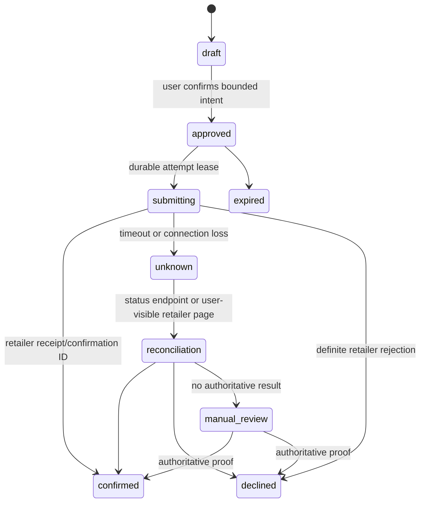

# OpenTCG execution plan

This plan turns the Mac-first, local-first architecture into an independently
written public repository. It assumes one experienced macOS engineer, one
part-time design/product reviewer, and a permitted data source for the first
adapter. The proposed license for original code, documentation, and test
fixtures is Apache-2.0, subject to final M0 confirmation. Estimates are planning
ranges, not promises; no phase buys cloud capacity, retailer access, or a paid
data feed without a named budget owner.

The order is intentional: prove a lawful, useful watch before building the
surfaces that make a shopping agent appear more capable than it is. A completed
milestone means its acceptance checks pass on a clean machine and the stated
evidence is attached to the release issue. M0–M5 are a 7–11 week development
path under these assumptions; the two-week first sprint is only a local vertical
slice. A pilot month is an evidence-collection period, not the date the product
is complete.

## Milestones and dependencies

| Milestone | Depends on | Estimated effort | Deliverable | Acceptance evidence |
|---|---|---:|---|---|
| M0: product and source charter | — | 3–5 days | public scope, terminology, supported-source registry template, data/retention statement | one candidate source has written access basis, field mapping, rate budget, attribution/link rule, disable condition, and test fixtures; no automation claim beyond its evidence |
| M1: local foundation | M0 | 1–2 weeks | SwiftUI shell, domain/store modules, migrations, watch CRUD, import/export | migration upgrade and rollback tests; offline-created watch survives relaunch; export excludes secrets; accessibility smoke test |
| M2: permitted observation loop | M0, M1 | 1–2 weeks | one approved adapter, scheduler, normalizer, evidence/history views | contract fixtures, source-budget test, redirect/SSRF rejection test, deterministic clock/backoff test, fresh/stale/unknown UI cases |
| M3: alert reliability | M1, M2 | 1 week | condition evaluator, durable leases, transactional outbox, local notifications | crash between fetch and notify produces at most one alert; retry/idempotency suite; sleep/offline/resume simulation; notification denial fallback |
| M4: private alpha | M1–M3 | 1–2 weeks | signed alpha build, diagnostics export, local privacy controls, founder test script | 10 representative watches pass manual script; no raw response/URL leaks in diagnostics; source outage and policy-disable drills |
| M5: public beta/release readiness | M4 | 1–2 weeks | public repository, CI, SBOM/provenance, signed/notarized artifact or documented unsigned developer build | clean clone build; contributor path works; license/security policy present; release checklist, signature/notarization and clean-install checks pass |
| M6: second source and post-v1 local-store pilot | M5 | 1–3 weeks per source | separately reviewed adapters and optional selected-store flow | each source passes M2/M3 contracts independently; location is opt-in; manual store fallback remains usable |
| M7: account/cloud decision | M5 plus funded operating plan | 2–4 week design/spike | explicit hosted-service proposal or recorded defer decision | cost model, privacy review, deletion/export behavior, incident ownership, and source scale approval are accepted before implementation |
| M8: retailer-authorized assisted purchase | M7 plus retailer agreement/API | 4–8 weeks per retailer | narrow checkout integration or browser handoff enhancement | see purchase authority gate below; no full purchase attempt until all consent, idempotency, and confirmation cases pass |

M0 through M5 produce a credible open-source alternative to basic collector
watching. Rich catalog trends, success feed, queues, saved retailer sessions,
and automated checkout are later experiments, not promises on the v1 roadmap.

## First sprint: two weeks

The sprint goal is an offline, inspectable vertical slice with no retailer
network calls. It reduces the largest implementation risk first: durable local
state and honest status semantics.

1. Create a new isolated Git folder for the standalone product; do not place
   product implementation in this operations repository. At M0, confirm the
   proposed Apache-2.0 license and repository owner/name, then create the
   required **public** remote for this new repository. Do not publish or alter
   an existing repository. Add `LICENSE`, `README`, `SECURITY.md`,
   `CONTRIBUTING.md`, `CODE_OF_CONDUCT.md`, `SUPPORT.md`, and an architecture
   decision record explaining the independent-build constraint.
2. Set up an Xcode project with Swift packages:
   `CollectorDomain`, `CollectorStore`, `CollectorScheduler`,
   `CollectorAdapters`, `CollectorDiagnostics`, and `CollectorApp`. Enforce
   one-way dependencies: UI depends on domain/application services, adapters
   depend on domain contracts, and only store owns SQL.
3. Define versioned Codable contracts for `ProductRef`, `WatchCondition`,
   `Observation`, `CheckRun`, `Alert`, `SourcePolicy`, and diagnostic records.
   Write JSON round-trip and invalid-version tests before UI work.
4. Implement SQLite migration 001 plus repository operations and append-only
   observation/history records. Enable foreign keys, use WAL after confirming
   the database is local, and make database-open/recovery failures visible.
5. Build watch create/edit/disable/delete, manual URL validation against an
   empty allowlist, history list, and the explicit statuses `never_checked`,
   `stale`, `offline`, `paused`, and `unsupported`. The empty allowlist makes
   this a safe local-only UI until M0 authorizes an adapter.
6. Implement a deterministic fake clock, fake connectivity monitor, and fake
   adapter. Exercise scheduled → running → observed/no-match/alert-pending and
   transient failure → backoff. Do not invoke network APIs.
7. Add an export preview that writes only selected non-secret fields to a
   user-chosen file. Add snapshot tests for redaction and a manual VoiceOver,
   keyboard-navigation, and Dynamic Type pass.
8. Add CI for unit tests, formatting/lint, dependency lock verification, secret
   scan, and a release-mode build. Attach a simple developer quick-start and
   threat-model test matrix to the PR.

Sprint exit: a new tester can create a watch, inject a fake matching
observation, see exactly one pending alert/history record after relaunch, and
export a redacted history. No production retailer URL is fetched and no user
permission dialog is requested.

## Work packages after sprint

### M0 source-review packet

For every proposed source, a maintainer completes a review document before code
is merged. It includes the official policy/API/feed URL, permission holder and
date checked, a yes/no answer for commercial use and polling, field provenance,
minimum polling interval, concurrency/rate cap, redirect hosts, user-agent
requirements, response retention, attribution, and an off-switch owner.
Ambiguity is a **no**. A source whose permitted access cannot support the user
story is labelled `manual browser handoff only`.

The initial candidate should be a documented public product API or a partner
feed, not a website discovered through DOM automation. Store only sanitized
fixtures supplied or permitted for tests. The PR must show an adapter manifest
and fixtures with recorded timestamps; it must not add a general HTML scraping
library as a shortcut.

### M2–M3 observation and alert implementation

Implement the `SourceAdapter` contract from the architecture document. The
scheduler gets a source policy before scheduling, creates a durable lease, and
writes observations/alerts/outbox together. The notification handler is an
idempotent consumer; it never evaluates conditions or changes a watch.

Required automated cases:

- target-price cents and currency mismatch; missing price/stock; variant
  mismatch; and a stale observation do not produce a false match;
- 301/302 redirects to an unapproved host, loop, private IP, or non-HTTPS URL
  fail closed;
- source budgets enforce per-host concurrency and spacing;
- app termination before/after each transaction boundary recovers a lease and
  emits no duplicate alert; 100 intermittent unknown/stale/offline results
  followed by the same match produce no additional alert;
- repeated identical matching observations stay within one durable alert
  transition; unknown/stale/offline results preserve the match latch; only a
  verified no-match → match or configured material price/stock change after
  cooldown creates one new transition, and delivery remains once under its
  dedupe key;
- changing a rule shows a changed-eligibility preview and never alerts by
  itself; an explicit user request is required before any new alert transition;
- clock jumps, sleep/wake, no network, notification denial, and a disabled
  source are rendered as their named states;
- adapter fixture changes are reviewed: a parser cannot silently reinterpret an
  unavailable field as `in_stock`.

The private alpha has **no telemetry**. A user may initiate a redacted
diagnostics export and attach it to an issue. There is no background analytics
collection or hidden log upload. Use the platform notification path only after
the user has asked for alerts; local notification APIs are for important
user-requested information ([Apple documentation](https://developer.apple.com/documentation/UserNotifications/scheduling-a-notification-locally-from-your-app)).

### M4 alpha operations

Recruit a small group of collectors who understand the app is observational.
Provide a short test script covering created watch, target alert, price change,
source unavailable, stale display, disabled watch, import/export, sleep/wake,
and browser handoff. Collect bugs through GitHub Issues using a structured
template that forbids credentials, full payment data, session cookies, and raw
retailer response bodies.

Exit criteria are qualitative and operational: no duplicate alert report after
a 48-hour test window, every alert has source/time/freshness visible, a local
user source-disable takes effect without an app update, and support can
reproduce common failures from redacted diagnostics. A remotely distributed
revocation list is out of scope unless a separately designed authenticated,
non-executable update channel exists. If the first source produces persistent
access/policy ambiguity, remove it and ship a manual-list/local-only alpha
instead of routing around the restriction.

### M5 public release

Before public beta, use a clean macOS account/VM to validate installation,
sandbox data location, notification behavior, wake behavior, and removal/data
export. For direct distribution, build with hardened runtime and Developer ID,
then notarize; Apple requires valid signatures, Developer ID and hardened
runtime for its normal notarization flow
([Apple notarization guidance](https://developer.apple.com/documentation/security/notarizing-macos-software-before-distribution)).
If signing capacity is unavailable, the artifact is explicitly a developer
build, not a trusted release.

Publish source under the confirmed Apache-2.0 license, source archive checksum,
SBOM, reproducible-build notes (or a clear statement of current gaps), release
notes, and a rollback path. Do not enable auto-update until a spike has
demonstrated verification of the exact selected signed manifest and/or archive
format. A candidate mechanism, Sparkle, validates update signatures and Apple
code signatures, but still needs release-specific validation
([Sparkle documentation](https://github.com/sparkle-project/Sparkle)).

## Public repository blueprint

```text
open-tcg/
  Apps/macOS/                    # SwiftUI application target and UI tests
  Packages/
    CollectorDomain/             # models, condition evaluation, state machine
    CollectorStore/              # migrations, repositories, recovery
    CollectorScheduler/          # clock, budgets, leases, outbox dispatch
    CollectorAdapters/           # contract, approved source modules, fixtures
    CollectorDiagnostics/        # redaction and explicit export
  Tests/
    Unit/ Contract/ Integration/ Snapshot/ Security/
  Docs/
    architecture.md source-policy.md privacy.md threat-model.md adr/
    adapters/                    # one review packet per source
    releases/                    # checklists and supported-version policy
  Scripts/                       # build, test, sign, notarize; no secrets
  .github/
    workflows/ ISSUE_TEMPLATE/ PULL_REQUEST_TEMPLATE.md
  SECURITY.md  CONTRIBUTING.md  CODE_OF_CONDUCT.md  LICENSE  README.md
```

A public contributor must be able to run unit/contract tests with fixtures and
no account, secret, retailer login, or live retail call. Require a small,
reviewable PR; an adapter PR needs its policy packet and fixtures; a schema PR
needs forward migration and recovery test; a security-sensitive PR needs a
maintainer sign-off. Use dependency updates through reviewed PRs with lockfile
changes and CI provenance, never an unreviewed updater with repository write
permission. Define a responsible disclosure path in `SECURITY.md`, publish
supported versions, and credit reporters only with permission.

## Spikes and decisions that block scope

| Spike / decision | Time box | Go evidence | Stop/defer trigger |
|---|---:|---|---|
| first-source permission | 2–3 days | official written terms/API agreement supports selected polling and attribution | permission unclear, login-only, anti-bot measure, or usage cost owner absent |
| macOS lifecycle and notification reliability | 2 days | wake/quit/relaunch script proves state recovery and one alert per evidence record | local app cannot meet promised freshness; narrow promise to foreground-only |
| database recovery | 2 days | fault-injection test at each transaction boundary passes; backup/export reopens | corruption or unbounded WAL growth without a safe operational remedy |
| direct-release signing/notarization | 1–2 days | clean artifact signature, notarization ticket, first-launch and upgrade pass | no Developer ID/release owner; ship source/developer build only |
| update framework | 2 days | tampered selected signed archive/enclosure is rejected; if a signed manifest is selected, its tampering is rejected too; key rotation and rollback documented | missing key custody plan, unsigned selected update artifact, or untestable rollback |
| local store inventory | 3–5 days per source | permitted inventory endpoint plus a manual selected-store comparison | only protected website flow or inaccurate inventory fields |
| cloud sync | 1 week design | cost, deletion, abuse controls, operations owner, privacy notice, and source scale all approved | any one is missing; retain local-only |
| assisted purchase | 1–2 weeks discovery | retailer authorization/API plus explicit purchase authority and confirmation semantics | browser/session automation, queue bypass, or payment capture would be required |

These are gates, not engineering invitations to defeat a restriction. A
negative spike result is useful: record it in the source registry, keep browser
handoff, and choose another source or narrower experience.

## Future purchase authority and cost controls

A future retailer-approved purchase adapter is a separate capability with a
strictly scoped purchase budget. It cannot reuse the watch polling authority.

The user creates a `PurchaseIntent` that contains retailer, product/variant,
maximum all-in price and currency, quantity (default 1), shipping/tax policy,
single-use expiry, an explicit approval timestamp, and a random idempotency
key. It never stores card data; approved payment handling must remain with the
retailer or a compliant payment provider. The app displays the estimated total,
budget remaining, and retailer confirmation before submission.



Rules for this state machine:

- Deduplicate on the tuple (retailer, account reference, `PurchaseIntent`
  idempotency key) and, where the retailer supports it, pass that key to its
  API. Persist the attempt before sending.
- A timeout is `unknown`, never a safe retry. Reconcile with the retailer's
  official status/receipt API using the same key; if unavailable, open a
  user-visible order-history page and require human resolution.
- The scheduler blocks all equivalent intents while any submission is `unknown`:
  equivalence includes the retailer, account reference, product/variant,
  quantity, and destination. A new approval or a new intent ID does not bypass
  this block. Reconcile to an authoritative confirmed or declined outcome before
  another purchase can be submitted.
- Reserve the worst-case authorized amount when submitting. The reservation
  persists through `unknown`, manual review, and post-submission expiry; release
  it only on an authoritative decline. A receipt settles the actual total.
  Multiple intents cannot collectively exceed a user-defined daily and
  per-item cap. Expiry may cancel only an unsubmitted approved intent.
- Quantity defaults to one and cannot be increased after approval. Any product,
  variant, shipping destination, currency, tax estimate, or max-price change
  invalidates approval.
- Logs retain hashes/IDs, outcome, and amount; never PAN/CVV, cookies, or raw
  auth headers. A user can view and export the purchase ledger.
- Purchases, checkout, cart changes, and queues are always foregrounded and
  explicitly confirmed until both retailer permission and a separate safety
  review authorize anything narrower.

A v1 browser handoff has no purchase budget because it has no purchase
authority. Its history entry remains `opened retailer URL`, not `ordered`.

## Definition of done and release checklist

A release candidate cannot be called ready until all of these are checked:

- source scope and every enabled adapter's permission packet are current;
- test suite covers contracts, migrations, recovery, budgets, redaction,
  redirect validation, alert idempotency, offline/sleep UI, and accessibility
  basics;
- clean-install, upgrade, and uninstall/data-export paths have been manually
  tested on supported macOS versions;
- all watch and alert screens surface source, observation time, freshness, and
  unknown/error status;
- notifications/location/keep-awake are off until in-context consent and remain
  revocable;
- diagnostics preview is redacted; no retailer credentials, payment data,
  cookie, product URL, or raw response escapes by default;
- dependency/licenses/vulnerability scan and security review are complete;
- source tarball, checksums, SBOM/provenance, changelog, support instructions,
  known limitations, and rollback procedure are published;
- artifact is signed, notarized, and ticket-stapled for a direct public
  release, or clearly marked as an unsigned developer build;
- a local user can disable an adapter without pretending an observation is fresh;
- public issues and CONTRIBUTING rules explain that contributors must not submit
  vendor code, copied UI/assets, credentials, or prohibited automation.

## Remaining uncertainties

The plan deliberately does not assume that any named retailer allows polling,
inventory access, queue interactions, or checkout. The first enabled source,
release channel, license, supported macOS floor, retention periods, and budget
owner remain founder decisions after the M0/M5 spikes. “Free” is feasible for a
local-only app with no required cloud service; a hosted catalog, push scanning,
shared community feed, or account sync needs a separate funding and privacy
decision before it can be offered honestly.
